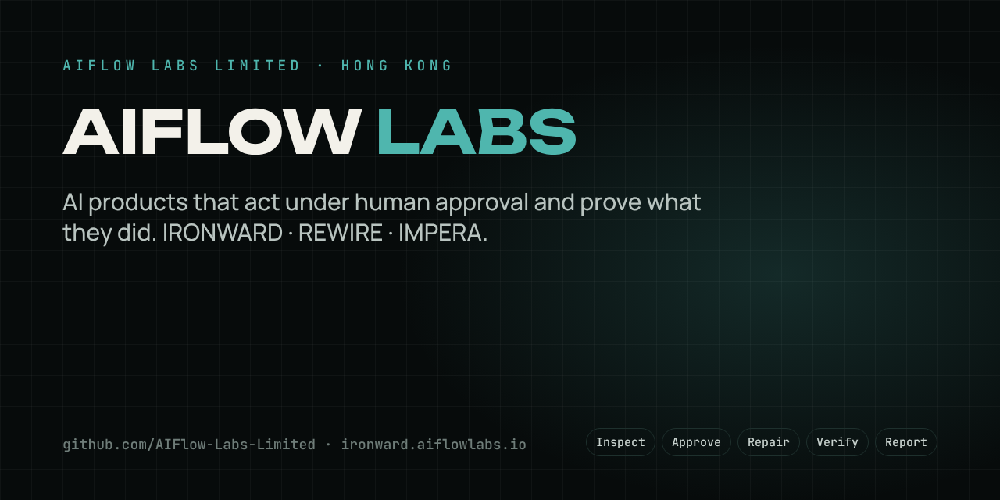

## AIFLOW LABS LIMITED
**AI products that act under human approval and prove what they did.**
Hong Kong company · registered office in Sheung Wan · Company No. 78586258

### Products
| | Product | What it does | Status |
|---|---|---|---|
| 🛡️ | [**IRONWARD**](https://github.com/AIFlow-Labs-Limited/ironward) | Governed AI security operations for companies with no security team: AI agents do the work, a named person approves each change, a separate check verifies it, the customer keeps the evidence. | Prototype · Hong Kong pilots |
| 🌐 | [**IRONWARD-WEB**](https://github.com/AIFlow-Labs-Limited/ironward-web) | Authorised AI attack testing of your own web application, ending in a code-fixing plan. | In development |
| ⛓️ | [**IRONWARD-WEB3**](https://github.com/AIFlow-Labs-Limited/ironward-web3) | Smart-contract review for tokenization projects, delivered with corrected code. | In development |
| 🧠 | [**REWIRE**](https://rewire.aiflowlabs.io) | Model engineering: AI agents edit a model's internals, signed, proven and reversible. | Research programme |
| 🤖 | [**IMPERA**](https://impera.aiflowlabs.io) | Robots programmed in plain language, verified by cameras. | Software complete |

### Work with us
Paid security diagnostics, pilots and engineering engagements: **ilessio@aiflowlabs.io** · [aiflowlabs.io](https://aiflowlabs.io) · [Day Zero — Hong Kong](https://ironward.aiflowlabs.io/day-zero)

Product repositories contain product information; source code is proprietary unless a repository says otherwise.
