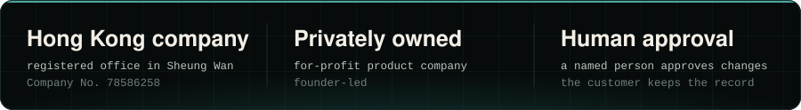

<a href="https://aiflowlabs.io"><picture><source media="(prefers-color-scheme: dark)" srcset="assets/header-dark.svg"><source media="(prefers-color-scheme: light)" srcset="assets/header-light.svg"></picture></a>

## Products

Each product follows the same loop: inspect, approve, repair, verify, report. The AI does the work, a named person approves it, and the customer keeps the record.

<a href="https://github.com/AIFlow-Labs-Limited/ironward"><picture><source media="(prefers-color-scheme: dark)" srcset="assets/card-ironward-dark.svg"><source media="(prefers-color-scheme: light)" srcset="assets/card-ironward-light.svg"></picture></a>

<a href="https://github.com/AIFlow-Labs-Limited/ironward-web"><picture><source media="(prefers-color-scheme: dark)" srcset="assets/card-ironward-web-dark.svg"><source media="(prefers-color-scheme: light)" srcset="assets/card-ironward-web-light.svg"></picture></a>&nbsp;<a href="https://github.com/AIFlow-Labs-Limited/ironward-web3"><picture><source media="(prefers-color-scheme: dark)" srcset="assets/card-ironward-web3-dark.svg"><source media="(prefers-color-scheme: light)" srcset="assets/card-ironward-web3-light.svg"></picture></a>

<a href="https://github.com/AIFlow-Labs-Limited/rewire"><picture><source media="(prefers-color-scheme: dark)" srcset="assets/card-rewire-dark.svg"><source media="(prefers-color-scheme: light)" srcset="assets/card-rewire-light.svg"></picture></a>&nbsp;<a href="https://github.com/AIFlow-Labs-Limited/impera"><picture><source media="(prefers-color-scheme: dark)" srcset="assets/card-impera-dark.svg"><source media="(prefers-color-scheme: light)" srcset="assets/card-impera-light.svg"></picture></a>

| Product | Status | Repository | Site |
|---|---|---|---|
| **IRONWARD** | Prototype · Hong Kong pilots | [ironward](https://github.com/AIFlow-Labs-Limited/ironward) | [ironward.aiflowlabs.io](https://ironward.aiflowlabs.io) |
| **IRONWARD-WEB** | In development | [ironward-web](https://github.com/AIFlow-Labs-Limited/ironward-web) | [ironward.aiflowlabs.io](https://ironward.aiflowlabs.io) |
| **IRONWARD-WEB3** | In development | [ironward-web3](https://github.com/AIFlow-Labs-Limited/ironward-web3) | [ironward.aiflowlabs.io](https://ironward.aiflowlabs.io) |
| **REWIRE** | Research programme | [rewire](https://github.com/AIFlow-Labs-Limited/rewire) | [rewire.aiflowlabs.io](https://rewire.aiflowlabs.io) |
| **IMPERA** | Software complete · awaiting hardware bring-up | [impera](https://github.com/AIFlow-Labs-Limited/impera) | [impera.aiflowlabs.io](https://impera.aiflowlabs.io) |

## Who we are

AIFLOW LABS LIMITED is a Hong Kong company with its registered office in Sheung Wan, privately owned and for-profit. We build AI products that act under human approval and prove what they did.

<picture><source media="(prefers-color-scheme: dark)" srcset="assets/strip-dark.svg"><source media="(prefers-color-scheme: light)" srcset="assets/strip-light.svg"></picture>

## Contact

Paid security diagnostics, pilots and engineering engagements:

[ilessio@aiflowlabs.io](mailto:ilessio@aiflowlabs.io) &nbsp;·&nbsp; [aiflowlabs.io](https://aiflowlabs.io) &nbsp;·&nbsp; [Day Zero, Hong Kong](https://ironward.aiflowlabs.io/day-zero) &nbsp;·&nbsp; [Founder: Igor Lessio](https://github.com/AIFlowML)

Product repositories contain product information; source code is proprietary unless a repository says otherwise.
